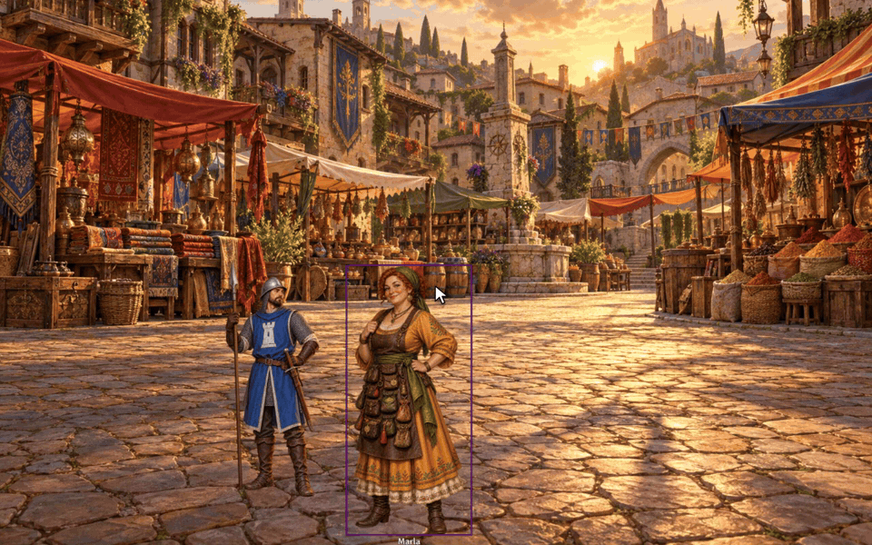

# Sephral’s Vista Portrait Switcher

**Bring the NPCs in Ember's Vistas to life.** The merchant turns suspicious, the guard reaches for his sword, the innkeeper bursts out laughing. One click, and the figure changes with a soft transition, right in the middle of the conversation.

*The demo uses its own characters and market backdrop instead of Ember's artwork.*

## Highlights

* **Moods at a click:** right click an NPC in a Vista and pick a portrait from the palette in the token HUD. The palette stays open for the next change.
* **A gallery per character:** as many portraits as you like, for moods, outfits, poses or disguises. Name them, sort them, mirror them.
* **Set up in seconds:** import a whole folder at once, or let the gallery suggest matching images such as *merchant_angry* next to *merchant*. That also finds the extra portraits Ember already ships for some NPCs.
* **Fits any figure:** every portrait can have its own height, so kneeling or sitting figures keep the right size and their place in the Vista.
* **Whole crowds:** every guard of a squad can show a different mood.
* **Remembers the choice:** a character keeps its portrait, and new tokens in a Vista start with it.
* **Soft transitions:** fade, swirl, morph, hologram and more.
* **Heroes too:** groups who place their heroes in Vistas can let players switch their own portraits.

## How it works

1. Right click an NPC in the actor directory and choose *Vista portraits*.
2. Add images, import a folder or let the gallery suggest alternates.
3. In a Vista, right click the NPC, click the mask button in the token HUD and pick a portrait.

Everyone sees the change right away.

## Install

Search for **Vista Portrait Switcher** in Foundry's module browser or open the [package page](https://foundryvtt.com/packages/sephrals-vista-portrait-switcher).

Foundry VTT 14 · Ember with Crucible or D&D 5e · English and German

The module needs your copy of the Ember module and contains no Ember content itself. On scenes that are not Vistas it stays out of the way. After an update of Ember or Foundry the GM gets a short notice, and a self test in the module settings checks that everything still works.

**Tip:** portraits look best as transparent full body figures with the feet at the lower edge, like Ember's own Vista portraits.

## Learn more

Questions or ideas? Join us on [Discord](https://discord.gg/7BjCgDYaBP). Looking for more? See [all modules by Sephral](https://github.com/Sephral).

## License

See [LICENSE.md](LICENSE.md).
